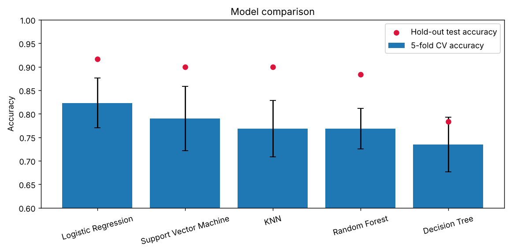
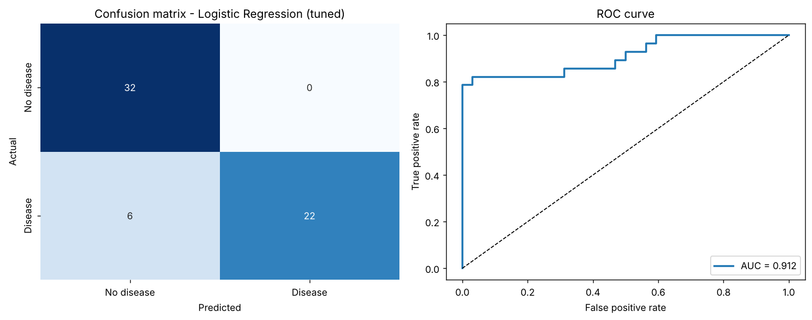
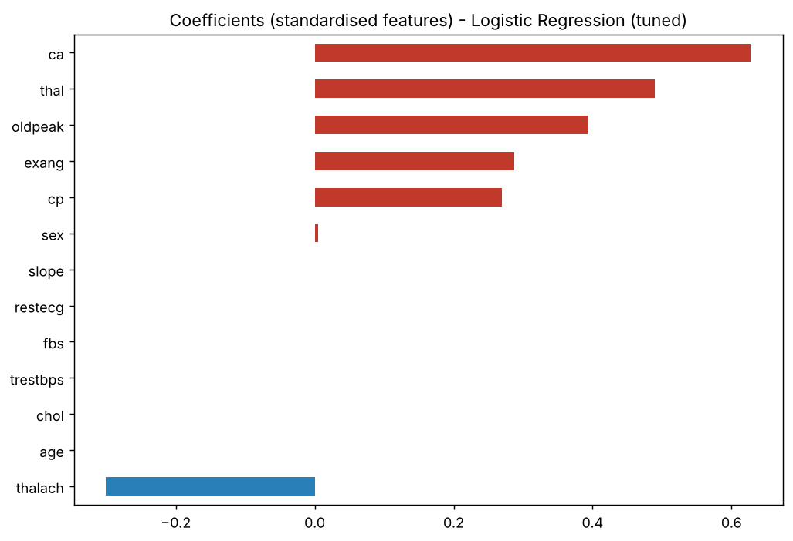

# ❤️ Heart Disease Prediction using Machine Learning


An end-to-end machine learning project that predicts whether a patient has heart disease from 13 clinical measurements. Five classifiers are compared, two models are tuned with GridSearchCV, the final model is chosen by cross-validation, and it is saved as a single scikit-learn `Pipeline` that accepts raw patient values.

> ⚠️ **Educational project – not a medical device.** The model is trained on 297 patients from one clinic and must not be used for real diagnosis.

---

## 📊 Results

Five models were trained on an 80/20 stratified split (237 train / 60 test patients) and also scored with 5-fold cross-validation on the training set:

| Model | CV accuracy | Test accuracy | Test precision | Test recall | Test ROC-AUC |
|---|---|---|---|---|---|
| **Logistic Regression** | **0.823 ± 0.053** | **0.917** | 1.000 | 0.821 | 0.953 |
| SVM | 0.790 ± 0.068 | 0.900 | 1.000 | 0.786 | 0.940 |
| KNN | 0.769 ± 0.060 | 0.900 | 1.000 | 0.786 | 0.959 |
| Random Forest | 0.768 ± 0.043 | 0.883 | 0.957 | 0.786 | 0.940 |
| Decision Tree | 0.735 ± 0.058 | 0.783 | 0.800 | 0.714 | 0.779 |

Logistic Regression and Random Forest were then tuned with `GridSearchCV`. The **final model is chosen by cross-validated ROC-AUC on the training set only** (never by the test score):

| Candidate | CV ROC-AUC |
|---|---|
| Logistic Regression (default) | 0.876 |
| **Logistic Regression (tuned: L1, C = 0.1)** | **0.896** |
| Random Forest (tuned) | 0.884 |

**Final model – tuned Logistic Regression** on the untouched test set: accuracy **0.90**, precision **1.00**, recall **0.79**, ROC-AUC **0.912**.

<p align="center">
  
  
</p>

**Caveats**

- The test set has only 60 patients (one patient ≈ 1.7 percentage points). Cross-validated accuracy (~82%) is the more realistic estimate; the hold-out split turned out to be an easy one.
- Recall is 79%: about one in five patients with heart disease is still missed, which matters in any screening use.

---

## 📂 Dataset

[Cleveland Heart Disease data](https://archive.ics.uci.edu/dataset/45/heart+disease) (UCI Machine Learning Repository): **297 patients, 13 features, no missing values, no duplicates**, 54% healthy / 46% disease.

| Feature | Description |
|---|---|
| `age` | Age in years |
| `sex` | 1 = male, 0 = female |
| `cp` | Chest pain type (0–3) |
| `trestbps` | Resting blood pressure (mm Hg) |
| `chol` | Serum cholesterol (mg/dl) |
| `fbs` | Fasting blood sugar > 120 mg/dl |
| `restecg` | Resting ECG result (0–2) |
| `thalach` | Maximum heart rate achieved |
| `exang` | Exercise-induced angina |
| `oldpeak` | ST depression induced by exercise |
| `slope` | Slope of the peak exercise ST segment |
| `ca` | Number of major vessels coloured by fluoroscopy (0–3) |
| `thal` | Thalassemia test result |
| `condition` | **Target** – heart disease present (1) or not (0) |

---

## 🔍 Key findings

- Disease is far more common with **chest-pain type 3**, **exercise-induced angina**, **more blocked vessels (`ca`)** and abnormal **thalassemia** results.
- Patients with disease reach a **lower maximum heart rate** and show higher **ST depression (`oldpeak`)**.
- The final model relies mainly on `ca`, `thal`, `oldpeak`, `exang`, `cp` and (protectively) `thalach`; the L1 penalty removed cholesterol, resting blood pressure, fasting blood sugar and other weak features.

<p align="center">
  
</p>

---

## 🧪 Method

```
Load & inspect → EDA → stratified 80/20 split → StandardScaler (fit on train only)
      → train & compare 5 classifiers (hold-out + 5-fold CV)
      → GridSearchCV on Logistic Regression and Random Forest
      → pick final model by CV ROC-AUC → evaluate on test set → save
```

- **No data leakage:** the final model is a single `Pipeline` (scaler + classifier), so it is fitted on training data only and accepts raw patient values.
- **Reproducible:** fixed `random_state = 42` everywhere; the notebook uses relative paths.

---

## 🚀 Getting started

```bash
git clone https://github.com/hemanthreddy2105/Heart-Disease-Prediction-ML.git
cd Heart-Disease-Prediction-ML
python -m venv .venv && source .venv/bin/activate   # Windows: .venv\Scripts\activate
pip install -r requirements.txt
```

**Re-run the analysis**

```bash
jupyter notebook notebooks/Heart_disease_predicting_analysis.ipynb
```

**Predict for a patient with the saved model**

```bash
python predict.py                                   # built-in example patient
python predict.py --age 40 --sex 0 --cp 1 --thalach 190 --oldpeak 0 --ca 0 --thal 0 --exang 0
```

```python
import joblib, pandas as pd
model = joblib.load("models/heart_disease_model.pkl")
patient = pd.DataFrame([{"age": 62, "sex": 0, "cp": 3, "trestbps": 160, "chol": 164, "fbs": 0,
                         "restecg": 2, "thalach": 145, "exang": 0, "oldpeak": 6.2,
                         "slope": 2, "ca": 3, "thal": 2}])
print(model.predict_proba(patient)[0, 1])           # probability of heart disease
```

> The saved model was created with scikit-learn 1.9; with a very different version, re-run the notebook to regenerate it.

---

## 📁 Project structure

```
Heart-Disease-Prediction-ML/
├── notebooks/
│   └── Heart_disease_predicting_analysis.ipynb   # full analysis with outputs
├── data/
│   └── heart_cleveland_upload.csv                # dataset
├── models/
│   └── heart_disease_model.pkl                   # saved final Pipeline (scaler + tuned model)
├── images/                                       # figures generated by the notebook
├── predict.py                                    # command-line prediction
├── requirements.txt
├── LICENSE
└── README.md
```

---

## 🔮 Future improvements

- Repeated or nested cross-validation for a tighter estimate on this small dataset.
- Tune the decision threshold for higher recall.
- Try gradient boosting (XGBoost / LightGBM).
- Wrap `predict.py` in a Streamlit web app.

---

## 👨‍💻 Author

**Hemanth Reddy** – Data Science student  
GitHub: [@hemanthreddy2105](https://github.com/hemanthreddy2105)

Released under the [MIT License](LICENSE).
