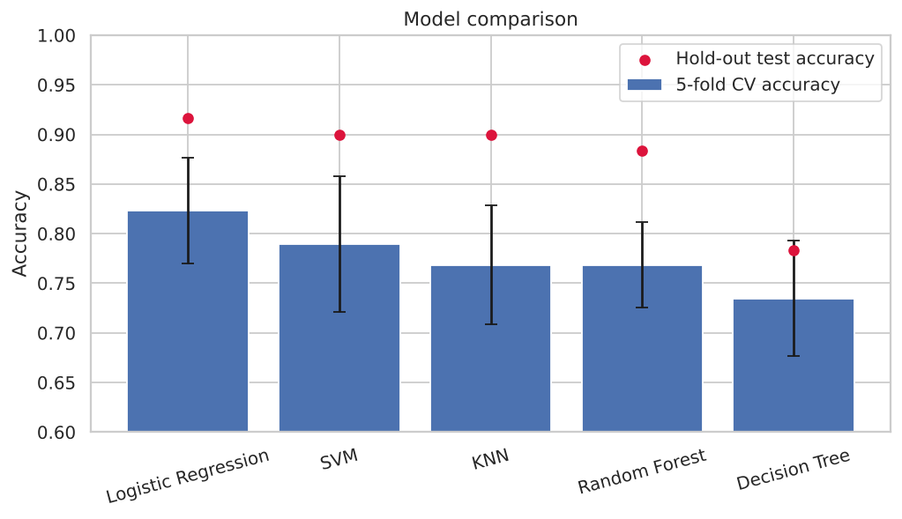
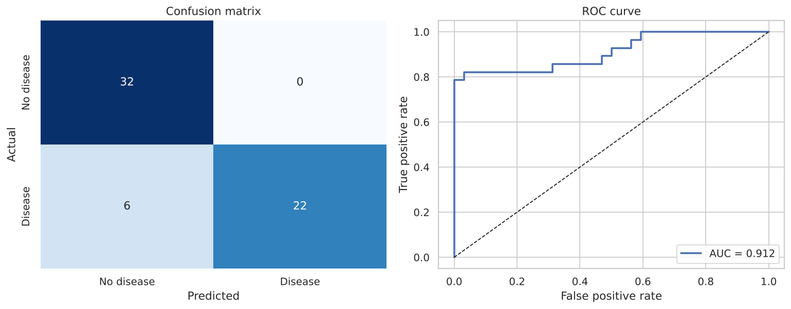
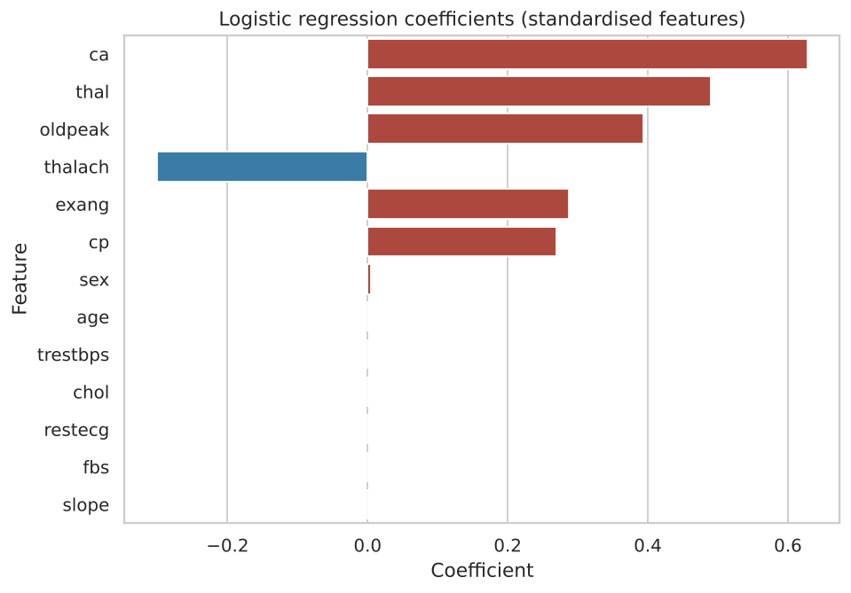
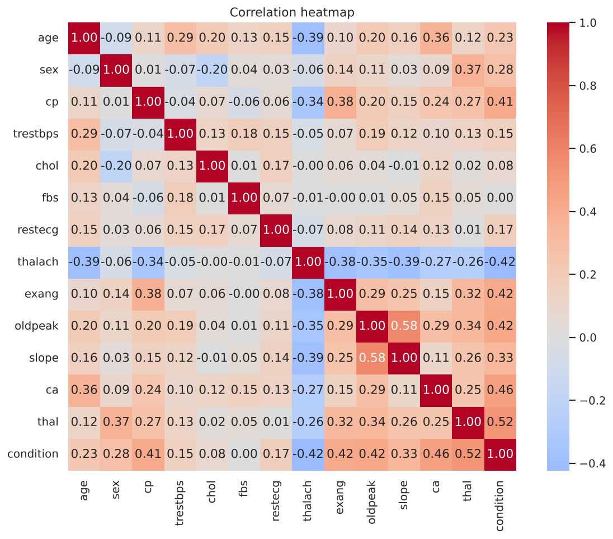

# ❤️ Heart Disease Prediction using Machine Learning


An end-to-end machine learning project that predicts whether a patient has heart disease from 13 clinical measurements. Five classifiers are compared with a hold-out test set **and** 5-fold cross-validation, the best one is tuned, and the final model is saved as a single scikit-learn `Pipeline` that accepts raw patient values.

> ⚠️ **Educational project – not a medical device.** The model is trained on 297 patients from one clinic and must not be used for real diagnosis.

---

## 📊 Results at a glance

| Model | CV accuracy (5-fold) | Test accuracy | Test recall | Test ROC-AUC |
|---|---|---|---|---|
| **Logistic Regression** | **0.823 ± 0.053** | 0.917 | 0.821 | 0.953 |
| SVM | 0.790 ± 0.068 | 0.900 | 0.786 | 0.940 |
| KNN | 0.769 ± 0.060 | 0.900 | 0.786 | 0.959 |
| Random Forest | 0.768 ± 0.043 | 0.883 | 0.786 | 0.945 |
| Decision Tree | 0.735 ± 0.058 | 0.783 | 0.714 | 0.779 |

**Final model – tuned Logistic Regression** (`L1`, `C = 0.1`, chosen by 5-fold CV ROC-AUC = 0.896):

| Hold-out test set (60 patients) | |
|---|---|
| Accuracy | 0.900 |
| Precision (disease) | 1.00 |
| Recall (disease) | 0.79 |
| ROC-AUC | 0.912 |

**How to read these numbers honestly**

- The test set has only 60 patients – one patient is ≈ 1.7 percentage points. The cross-validated accuracy (~82%) is a more conservative estimate of real performance than the ~90% hold-out score.
- Tuning improved cross-validated ROC-AUC (0.876 → 0.896) and produced a sparser model, but the hold-out score is slightly lower than the untuned model. That gap is within noise; the tuned model was kept because it was selected by cross-validation, not by peeking at the test set.
- Recall for the *Disease* class is 79%: the model still misses some sick patients, which would matter a lot in any screening use.

<p align="center">
  
  
</p>

---

## 📂 Dataset

[Cleveland Heart Disease data](https://archive.ics.uci.edu/dataset/45/heart+disease) (UCI Machine Learning Repository): **297 patients, 13 features, no missing values, no duplicates**, 54% healthy / 46% disease.

| Feature | Description |
|---|---|
| `age` | Age in years |
| `sex` | 1 = male, 0 = female |
| `cp` | Chest pain type (0–3) |
| `trestbps` | Resting blood pressure (mm Hg) |
| `chol` | Serum cholesterol (mg/dl) |
| `fbs` | Fasting blood sugar > 120 mg/dl |
| `restecg` | Resting ECG result (0–2) |
| `thalach` | Maximum heart rate achieved |
| `exang` | Exercise-induced angina |
| `oldpeak` | ST depression induced by exercise |
| `slope` | Slope of the peak exercise ST segment |
| `ca` | Number of major vessels coloured by fluoroscopy (0–3) |
| `thal` | Thalassemia test result |
| `condition` | **Target** – heart disease present (1) or not (0) |

---

## 🔍 Key findings

- Disease is far more common with **chest-pain type 3**, **exercise-induced angina**, **more blocked vessels (`ca`)** and abnormal **thalassemia** results.
- Patients with disease reach a **lower maximum heart rate** and show higher **ST depression (`oldpeak`)**.
- The final model relies mainly on `ca`, `thal`, `oldpeak`, `thalach` (protective), `exang` and `cp`; the L1 penalty shrinks six of the other seven features to exactly zero.

<p align="center">
  
  
</p>

---

## 🧪 Method

```
Load & inspect → EDA → stratified 80/20 split
      → Pipeline(StandardScaler → model) for 5 classifiers
      → rank by 5-fold CV accuracy → GridSearchCV (ROC-AUC) on the best
      → evaluate on held-out test set → coefficients → save Pipeline
```

- **No data leakage:** the scaler lives inside the `Pipeline`, so it is fitted on training folds only.
- **Reproducible:** fixed `random_state = 42` everywhere; the notebook uses relative paths.
- **Deployable:** the saved model is one `Pipeline`, so it takes raw (unscaled) feature values.

---

## 🚀 Getting started

```bash
git clone https://github.com/hemanthreddy2105/Heart-Disease-Prediction-ML.git
cd Heart-Disease-Prediction-ML
python -m venv .venv && source .venv/bin/activate   # Windows: .venv\Scripts\activate
pip install -r requirements.txt
```

**Re-run the analysis**

```bash
jupyter notebook notebooks/Heart_Disease_Prediction.ipynb
```

**Predict for a patient with the saved model**

```bash
python predict.py                                   # built-in example patient
python predict.py --age 40 --sex 0 --cp 1 --thalach 190 --oldpeak 0 --ca 0 --thal 0 --exang 0
```

```python
import joblib, pandas as pd
model = joblib.load("models/heart_disease_model.joblib")
patient = pd.DataFrame([{"age": 62, "sex": 0, "cp": 3, "trestbps": 160, "chol": 164, "fbs": 0,
                         "restecg": 2, "thalach": 145, "exang": 0, "oldpeak": 6.2,
                         "slope": 2, "ca": 3, "thal": 2}])
print(model.predict_proba(patient)[0, 1])           # probability of heart disease
```

> The saved `.joblib` was created with scikit-learn 1.9; if you use a very different version, re-run the notebook to regenerate it.

---

## 📁 Project structure

```
Heart-Disease-Prediction-ML/
├── notebooks/
│   └── Heart_Disease_Prediction.ipynb   # full analysis with outputs
├── data/
│   └── heart_cleveland_upload.csv       # dataset
├── models/
│   └── heart_disease_model.joblib       # saved Pipeline (scaler + tuned model)
├── images/                              # figures generated by the notebook
├── predict.py                           # command-line prediction
├── requirements.txt
├── LICENSE
└── README.md
```

---

## 🔮 Future improvements

- Nested cross-validation or repeated CV for a tighter performance estimate on this small dataset.
- Calibrate probabilities and tune the decision threshold for higher recall.
- Try gradient boosting (XGBoost / LightGBM) and compare against logistic regression.
- Wrap `predict.py` in a Streamlit app.

---

## 👨‍💻 Author

**Hemanth Reddy** – Data Science student  
GitHub: [@hemanthreddy2105](https://github.com/hemanthreddy2105)

Released under the [MIT License](LICENSE).
